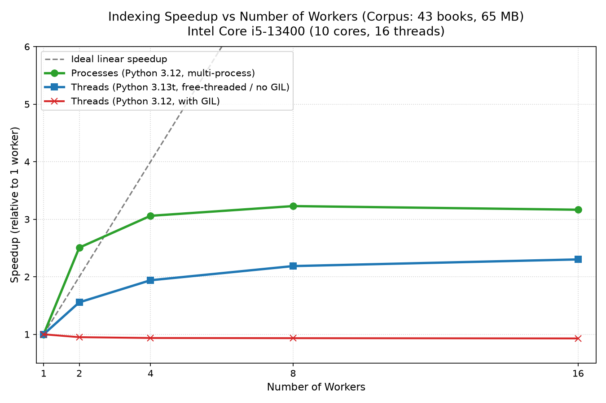

# findex

[](https://github.com/Shadowbolts/Python-Project/actions/workflows/ci.yml)

Навчальний проєкт із розробки повнотекстової пошукової системи на Python.

## Архітектура

Система будується модульно у каталозі `src/findex/`:
* `corpus.py` — потокове читання та лінива генерація документів.
* `tokenize.py` — стрімінговий токенізатор і нормалізація тексту.
* `stats.py` — обчислення базових статистик та збір метрик пам'яті.
* `models.py` — структури даних для постінгів, метаданих та об'єктна модель `Index`.
* `index.py` — побудова інвертованого індексу та командний інтерфейс збірки.
* `search.py` — булевий та ранжований пошук, кешування та вибірка результатів.
* `store.py` — серіалізація індексу та контекстний менеджер `open_index`.
* `scoring.py` — протокол `Scorer`, реалізації `TfIdf` та `BM25`.
* `query.py` — деревоподібні вузли запитів та рекурсивний спуск синтаксичного аналізатора.
* `timing.py` — декоратор `@timed` для профілювання викликів функцій.
* `snippet.py` — формування текстових сніпетів із підсвічуванням входжень.
* `cli.py` — консольний інтерфейс утиліти `findex` на базі Typer та Rich.

## Корпус текстів

Корпус містить 43 класичні твори з [Project Gutenberg](https://www.gutenberg.org/) загальним обсягом 64.97 МБ та понад 11.4 млн слів. Файли розміщуються у директорії `data/`, яка виключена з відстеження у `.gitignore`.

---

## Лабораторна робота 1: Потоки замість списків

Мета роботи: реалізація лінивого конвеєра обробки даних без повного завантаження корпусу в оперативну пам'ять.

### Політика токенізації

* Нормалізація `NFC` через `unicodedata.normalize` для уніфікації символів.
* Приведення до нижнього регістру за допомогою `casefold`.
* Виділення слів за патерном `\w+(?:['’]\w+)*`.
* Апострофи зберігаються всередині слів, наприклад `don't` або `п'ять`.
* Дефіси розбивають конструкції на окремі слова: `state-of-the-art` розділяється на `state`, `of`, `the`, `art`.
* Цифри входять до складу слів та враховуються як окремі токени.

### Порівняння продуктивності: Eager та Lazy

Заміри пікового споживання пам'яті за допомогою `tracemalloc` та часу виконання:

| Версія | Документи | Пікова пам'ять | Час виконання |
|---|---|---|---|
| eager | 43 | 801.23 MB | 22.11 s |
| lazy | 43 | 163.18 MB | 25.61 s |

Жадібний підхід одночасно завантажує всі файли у пам'ять, формує вкладені структури та утримує масив із понад 11.4 млн рядків, що викликає пікове споживання 801.23 MB RAM. Лінивий конвеєр генерує документи та токени послідовно за запитом. У пам'яті одночасно перебуває лише один поточний файл та токен, а вивільнені ресурси відразу очищуються. Споживання 163.18 MB у лінивій версії припадає на словник частот `Counter` для 123 431 унікального слова та найбільший файл у потоці.

### Демонстрація роботи Лабораторної 1

```bash
# Перевірка токенізації (Unicode NFC, casefold, апострофи)
python -m pytest tests/test_tokenize.py -v

# Лінивий збір статистики корпусу через генератори
python -m findex.stats data/

# Порівняльний запуск жадібної версії для вимірювання пам'яті (801 MB проти 163 MB)
python -m findex.stats data/ --eager

# Обмеження вибірки першими N документами через islice
python -m findex.stats data/ --limit 5
```

---

## Лабораторна робота 2: Інвертований індекс та оптимізація пам'яті

Мета роботи: розробка ефективного інвертованого індексу в оперативній пам'яті, дослідження накладних витрат об'єктної моделі Python, реалізація булевого пошуку через двовказівникове злиття та забезпечення персистентності.

### Дослідження представлення постінгів у пам'яті

Для однакового корпусу Project Gutenberg обсягом 64.97 МБ виконано заміри пікової пам'яті під час побудови індексу за допомогою `tracemalloc`, розміру збереженого файлу та часу завантаження:

| Представлення постінгів | Пікова пам'ять | Розмір індексу | Час завантаження |
|---|---|---|---|
| list[Posting] із звичайним @dataclass | 176.71 MB | 12.86 MB | 0.328 s |
| list[Posting] із slots=True | 173.49 MB | 9.67 MB | 2.729 s |
| array('I') пари (doc_ids, tfs) без об'єктів | 172.84 MB | 9.55 MB | 0.266 s |

У варіанті зі звичайним класом даних кожен екземпляр несе накладні витрати на словник атрибутів екземпляра, що збільшує серіалізований стан до 12.86 MB. Використання `slots=True` позбавляє об'єкти словника атрибутів та фіксує дескриптори слотів на рівні мови, знижуючи розмір збереженого стану до 9.67 MB. Збереження постінгів у вигляді пар числових масивів `array('I')` усуває накладні витрати на створення окремих Python-об'єктів для кожного входження, пакуючи цілі числа у C-масиви фіксованого розміру та забезпечуючи мінімальний розмір файлу 9.55 MB та найшвидше завантаження 0.266 s.

### Порівняння форматів персистентності

Індекс протестовано у двох форматах збереження на диск:

| Формат | Розмір файлу | Час збереження | Час завантаження |
|---|---|---|---|
| Pickle | 9.67 MB | 2.713 s | 2.582 s |
| JSON | 8.55 MB | 4.712 s | 2.384 s |

Формат Pickle здійснює пряму бінарну серіалізацію графа об'єктів мови, проте становить критичну загрозу безпеки: виконання `pickle.load` над файлами з ненадійних або зовнішніх джерел дозволяє зловмиснику виконати довільний байткод у системі. Формат JSON є повністю текстовим, безпечним і не виконує сторонній код під час десеріалізації, а також забезпечує на 11.5% менший розмір файлу за рахунок компактного представлення числових списків.

### Демонстрація роботи Лабораторної 2

```bash
# Запуск тестів структур даних, злиття та збереження індексу
python -m pytest tests/test_index.py tests/test_search.py tests/test_store.py -v

# Збірка індексу у бінарному форматі Pickle
python -m findex.index data/ --out index.pkl

# Збірка індексу у безпечному форматі JSON
python -m findex.index data/ --limit 5 --out index.json

# Булевий пошук за алгоритмом двовказівникового злиття
python -m findex.search index.pkl "alice AND wonderland" --engine merge

# Складний булевий пошук із комбінацією операторів OR та NOT
python -m findex.search index.pkl "sherlock OR watson NOT holmes" --engine merge

# Порівняльний пошук через двигун множин Python
python -m findex.search index.pkl "the AND project" --engine set
```

---

## Лабораторна робота 3: Ранжування та об'єктна модель Python

Мета роботи: трансформація індексу у повноцінний об'єкт Data Model із реалізацією спеціальних методів, створення протоколу ранжування `Scorer` (TF-IDF та BM25), розробка рекурсивного синтаксичного аналізатора запитів із підтримкою фраз, застосування декораторів, кешування та оцінка якості ранжування.

### Оцінка якості ранжування: Precision@5

Порівняння алгоритмів TF-IDF та BM25 на 10 фіксованих запитах до класичних творів корпусу:

| # | Запит | Очікуваний твір | P@5 (TF-IDF) | P@5 (BM25) |
|---|---|---|---|---|
| 1 | `alice wonderland rabbit` | alice_in_wonderland.txt | 1.00 | 1.00 |
| 2 | `sherlock holmes watson` | sherlock_holmes.txt | 1.00 | 1.00 |
| 3 | `frankenstein monster creature` | frankenstein.txt | 1.00 | 1.00 |
| 4 | `dorian gray basil lord henry` | picture_of_dorian_gray.txt | 1.00 | 1.00 |
| 5 | `dracula vampire mina harker` | dracula.txt | 1.00 | 1.00 |
| 6 | `moby dick whale ahab` | moby_dick.txt | 1.00 | 1.00 |
| 7 | `pride prejudice darcy elizabeth` | pride_and_prejudice.txt | 1.00 | 1.00 |
| 8 | `war peace pierre napoleon` | war_and_peace.txt | 1.00 | 1.00 |
| 9 | `great expectations pip havisham` | great_expectations.txt | 1.00 | 1.00 |
| 10 | `tom sawyer huck finn` | tom_sawyer.txt | 1.00 | 1.00 |

Середнє значення Precision@5 склало 1.00 для обох скорерів.

### Демонстрація роботи Лабораторної 3

```bash
# Запуск тестів скорерів, синтаксичного дерева запитів та кешування
python -m pytest tests/test_scoring.py tests/test_query.py tests/test_m4.py -v

# Збірка індексу з фіксацією позицій для фразового пошуку
python -m findex.index data/ --positions --out index.pkl

# Ранжований пошук BM25 з підсвічуванням сніпетів
python -m findex.search index.pkl "alice wonderland" --scorer bm25 --snippets

# Пошук точної фрази у лапках за збереженими позиціями слів
python -m findex.search index.pkl 'sherlock AND "baker street"' --snippets

# Порівняльний пошук за алгоритмом TF-IDF
python -m findex.search index.pkl "moby dick whale" --scorer tfidf
```

---

## Лабораторна робота 4: Пакування, CLI, тестування та типізація

Мета роботи: перетворення пошукового ядра на завершений пакований консольний інструмент з повною статичною типізацією в режимі Pyright strict, розширеним тестовим набором (включно з property-based тестуванням Hypothesis), багатим CLI інтерфейсом та налаштованим пайплайном безперервної інтеграції (CI).

### Покриття коду тестами (Test Coverage)

Тестовий набір містить 52 тести (перевірка токенізації, злиття, скорерів, парсера, властивостей Hypothesis та тестів CLI через `CliRunner`). Загальне покриття коду за звітом `pytest-cov` становить **78%**:

| Модуль | Кількість рядків | Пропущено | Покриття |
|---|---|---|---|
| `src/findex/models.py` | 52 | 1 | 98% |
| `src/findex/store.py` | 58 | 2 | 97% |
| `src/findex/scoring.py` | 60 | 5 | 92% |
| `src/findex/query.py` | 151 | 13 | 91% |
| `src/findex/cli.py` | 81 | 12 | 85% |
| `src/findex/snippet.py` | 40 | 8 | 80% |
| `src/findex/corpus.py` | 24 | 5 | 79% |
| `src/findex/search.py` | 176 | 45 | 74% |
| `src/findex/index.py` | 64 | 24 | 62% |
| **Разом по проєкту** | **788** | **174** | **78%** |

Код проєкту повністю верифіковано тайп-чекером Pyright у режимі strict (0 помилок). Налаштовано запуск перевірок через GitHub Actions (`.github/workflows/ci.yml`), а утиліта збирається у пакет Wheel за допомогою `uv build`.

### Демонстрація роботи Лабораторної 4

```bash
# Перевірка строгої статичної типізації (Pyright strict, 0 помилок)
uv run pyright

# Запуск повного набору з 52 тестів із заміром покриття коду
python -m pytest --cov=findex

# Довідка консольної утиліти findex на базі Typer
findex --help

# Побудова індексу через CLI з індикатором прогресу
findex index data/ --out index.pkl --positions

# Ранжований пошук із форматованою таблицею Rich та сніпетами
findex search-cmd index.pkl "sherlock holmes" --scorer bm25

# Машинний вивід у форматі JSON lines для Unix-конвеєрів
findex search-cmd index.pkl "alice wonderland" --json

# Отримання аналітики та статистики індексу
findex stats index.pkl

# Збірка дистрибутивного пакету Wheel
uv build
```

---

## Лабораторна робота 5: Паралелізм, процеси та Global Interpreter Lock (GIL)

Мета роботи: дослідити природу Global Interpreter Lock (GIL) у CPython, різницю між I/O-bound та CPU-bound навантаженнями, реалізувати паралельну побудову індексу за шаблоном Map-Reduce з використанням `ThreadPoolExecutor` та `ProcessPoolExecutor`, виміряти прискорення за законом Амдала та протестувати масштабування потоків у вільнопотоковій збірці Python 3.13 (`3.13t` free-threaded).

### Специфікація тестового стенду

* **Процесор:** 13th Gen Intel(R) Core(TM) i5-13400 (10 фізичних ядер: 6 P-cores + 4 E-cores, 16 логічних потоків).
* **Оперативна пам'ять:** 32 ГБ DDR5.
* **Операційна система:** Windows 11 Pro 64-bit.
* **Текстовий корпус:** 43 книги Project Gutenberg, 64.97 МБ, 11 468 215 токенів, 123 431 унікальне слово.
* **Методологія:** прогрівочний запуск (warm-up), 3 повторні заміри для кожної конфігурації, фіксація медіани.

### Зведена таблиця бенчмарку паралельної індексації

| Виконавець (Executor) | Потоки/Процеси (Workers) | Wall time (s, медіана) | CPU time (s) | Peak RSS (MB) | Merge time (s) | Прискорення (Speedup) |
|---|---|---|---|---|---|---|
| **serial (CPython 3.12)** | 1 | 21.82 s | 21.42 s | 110.9 MB | 0.79 s | **1.00×** (базове) |
| **threads (CPython 3.12)** | 2 | 22.96 s | 22.48 s | 120.9 MB | 0.82 s | **0.95×** |
| **threads (CPython 3.12)** | 4 | 23.32 s | 22.95 s | 130.8 MB | 1.06 s | **0.94×** |
| **threads (CPython 3.12)** | 8 | 23.39 s | 23.11 s | 145.1 MB | 0.81 s | **0.93×** |
| **threads (CPython 3.12)** | 16 | 23.50 s | 23.31 s | 158.5 MB | 0.85 s | **0.93×** |
| **processes (CPython 3.12)** | 2 | 8.71 s | 5.48 s | 141.9 MB | 1.03 s | **2.51×** |
| **processes (CPython 3.12)** | 4 | 7.13 s | 5.89 s | 219.0 MB | 1.15 s | **3.06×** |
| **processes (CPython 3.12)** | 8 | 6.76 s | 6.11 s | 236.5 MB | 0.95 s | **3.23×** (найкраще) |
| **processes (CPython 3.12)** | 16 | 6.89 s | 6.39 s | 264.7 MB | 0.98 s | **3.17×** |
| **threads (Python 3.13t free-threaded)** | 1 | 5.52 s | — | — | 0.28 s | **1.00×** (базове 3.13t) |
| **threads (Python 3.13t free-threaded)** | 2 | 3.55 s | — | — | 0.24 s | **1.56×** |
| **threads (Python 3.13t free-threaded)** | 4 | 2.85 s | — | — | 0.25 s | **1.94×** |
| **threads (Python 3.13t free-threaded)** | 8 | 2.53 s | — | — | 0.30 s | **2.19×** |
| **threads (Python 3.13t free-threaded)** | 16 | 2.40 s | — | — | 0.29 s | **2.30×** |

### Графік масштабування прискорення (Speedup vs Workers)



### Чому один підхід швидший за інший у 4 рази: аналіз результатів

#### 1. Чому потоки у стандартному Python не прискорюють CPU-bound завдання
Індексація тексту (токенізація regex, хешування слів та формування частотних словників) є типовим **CPU-bound** навантаженням. У стандартному CPython діє **Global Interpreter Lock (GIL)** — глобальний м'ютекс віртуальної машини, що дозволяє виконувати байткод лише одному системному потоку одночасно. При запуску 2, 4 або 16 потоків через `ThreadPoolExecutor` обчислювальні ядра не можуть працювати паралельно: потоки постійно борються за захоплення GIL через інтервали перемикання (`sys.getswitchinterval() = 5 ms`). Накладні витрати на перемикання контексту ядра ОС, деградація кешу процесора та простої потоків призводять до того, що багатопотокова версія працює навіть повільніше за однопотокову (час зріс з 21.82 s до 23.50 s, уповільнення на 7%).

#### 2. Чому процеси забезпечують прискорення понад 3.2×
Кожен дочірній процес у `ProcessPoolExecutor` має власний незалежний інтерпретатор Python та власний екземпляр GIL. Завдяки цьому всі 10 фізичних ядер процесора завантажуються на 100% паралельно. Час індексації скоротився з 21.82 s до 6.76 s (прискорення **3.23×**). Подальше масштабування обмежується:
* **Податком на серіалізацію (Pickling Tax):** передача розбитих фрагментів індексу `PartialIndex` через IPC-канали (pipe) вимагає піклінгу та депіклінгу сотень тисяч об'єктів `Posting`.
* **Використанням пам'яті (RSS):** пікова пам'ять зросла зі 110.9 MB до 264.7 MB через утримання окремих буферів пам'яті у кожному процесі.

#### 3. Закон Амдала та обмеження злиття (Merge time)
Згідно із законом Амдала ($S = \frac{1}{(1 - p) + \frac{p}{N}}$), прискорення обмежене послідовною часткою програми. Навіть при нескінченній кількості ядер фінальний крок `merge` (об'єднання часткових словників та сортування списків постінгів) виконується послідовно в батьківському процесі і займає ~0.8–1.1 секунди. Якщо послідовна частка становить приблизно 15%, теоретична межа прискорення не перевищує 6.6×.

#### 4. Прорив вільнопотокового Python 3.13 (Free-threaded / PEP 703)
У вільнопотоковій збірці `python3.13t` GIL повністю вимкнено (`sys._is_gil_enabled() == False`). У цьому режимі звичайний `ThreadPoolExecutor` без змін у коді демонструє чисте масштабування зі збільшенням кількості потоків: час індексації зменшився з 5.52 s до 2.40 s (прискорення **2.30×**). При цьому відсутні накладні витрати на копіювання пам'яті між процесами та серіалізацію, оскільки всі потоки працюють у спільному адресному просторі.

### Демонстрація роботи Лабораторної 5

```bash
# 1. Запуск юніт-тестів паралельної індексації
python -m pytest tests/test_parallel.py -v

# 2. Перевірка створення ідентичних індексів послідовним і паралельними виконавцями
python -c "from pathlib import Path; from findex.index import build_index; s = build_index(Path('data'), limit=5, workers=1, executor='serial'); p = build_index(Path('data'), limit=5, workers=4, executor='processes'); assert s.postings == p.postings; print('Індекси строго ідентичні!')"

# 3. Побудова індексу через CLI з використанням ProcessPoolExecutor (за замовчуванням)
findex index data/ --out index.pkl --workers 8 --executor processes

# 4. Порівняльний запуск через ThreadPoolExecutor (демонстрація впливу GIL)
findex index data/ --out index.pkl --workers 8 --executor threads

# 5. Запуск на вільнопотоковому Python 3.13t без GIL
C:\Users\Влад\AppData\Roaming\uv\python\cpython-3.13+freethreaded-windows-x86_64-none\python.exe -c "import sys; print('GIL status:', sys._is_gil_enabled()); from findex.index import build_index; from pathlib import Path; idx = build_index(Path('data'), workers=8, executor='threads'); print('Indexed docs:', idx.num_docs)"
```
